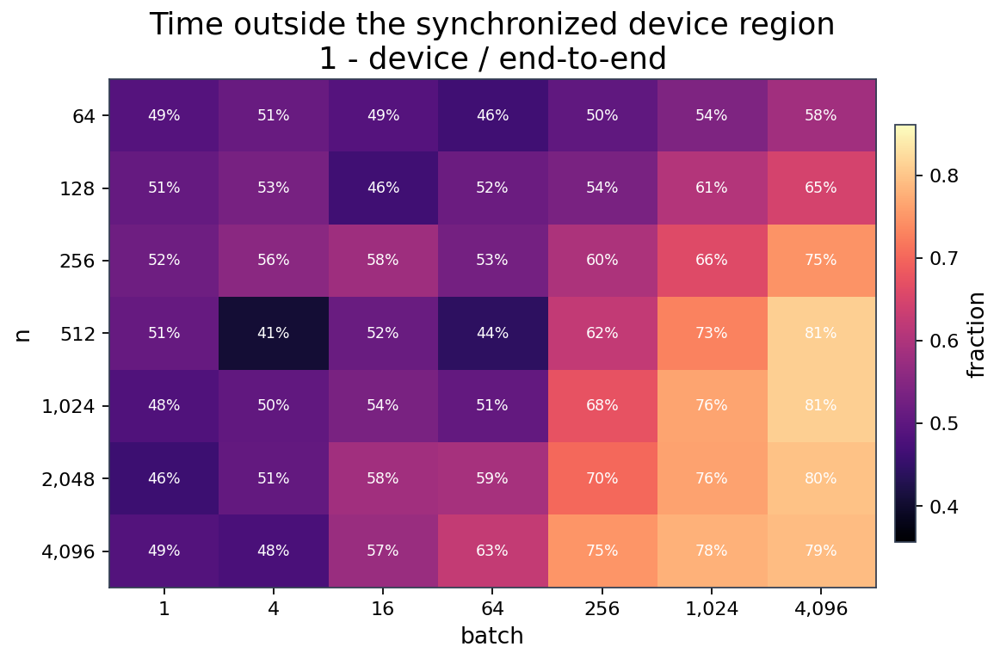

# 端到端与应用代理

## 实验问题

C2C 的 device-only 收益加入主机与设备搬运后还剩多少？对通信、雷达和深度学习中的代表
FFT 输入形状，迁移后的计算流能否保持收益？这里将稳态 FFT 调用的端到端时间与完整应用
执行时间明确区分。

## 配置与变量

两侧均在 Ascend910_9382 / CANN 9.0.0 上执行 fp32 前向 C2C。计时区间为
`pinned H2D -> FFT -> pinned D2H`，不含进程/框架启动、输入生成和 Plan 构造。
每点执行 3 轮、每轮 10 次，汇总取每轮均值的最小值。

| 实验 | 自变量与覆盖 | 严格基线 |
|---|---|---|
| 网格 E2E | 与 C2C 相同的 7 个长度 × 7 个 batch，共 49 点 | 同卡 torch_npu 前向 C2C，同搬运量 |
| OFDM 代理 | N=2048/4096，batch=14/140；16-QAM 子载波、DC/保护带置零 | 同语义 C2C，4 点 |
| 雷达代理 | N=1024/2048，batch=64/256；目标复指数回波 | 同语义 C2C，4 点 |
| DL 频域层代理 | N=1024/4096，batch=32/128；分块复激活 | 同语义 C2C，4 点 |

快照还保留裸 CANN `aclRfft1D` 的上下文数据，但它是实数到半谱变换，与这里的 C2C
搬运量和数学问题不同，不参与 C2C 胜负与几何均值。

## 从 device-only 到 E2E

图中两个计时区间分别计算速度比，不能把某点 kernel 的倍率直接当作该点 E2E 的倍率。

第二张图使用 `(E2E - device) / E2E` 描述非 device 区间占比。它包含搬运及相应调用/同步
开销，不能当作 MTE 硬件计数器的纯传输时间或用来证明计算与搬运已完全重叠。

## 数值结论

| 网格 E2E 指标 | 最新快照 |
|---|---:|
| 几何均值 speedup | **1.442x** |
| 严格胜 / 平 / 负 | **47 / 0 / 2** |
| ±5% 持平带的胜 / 平 / 负 | **45 / 4 / 0** |
| 最低 / 最高 speedup | **0.964x / 1.833x** |

严格统计比较未舍入值与 1；持平带将 `0.95..1.05` 视为近似持平，不代表统计显著性。
两个严格负点为 `N=1024,batch=4096`（0.964x）与 `N=4096,batch=1024`（0.974x）。
自研网格中非 device 区间占 E2E 的 **40.7%..81.1%**，说明只优化计算部分不足以决定
所有端到端结果。

## 应用形状的收益

| 应用代理 | 点数 | E2E 几何均值 | 严格领先点 |
|---|---:|---:|---:|
| OFDM | 4 | 1.476x | 4/4 |
| 雷达 | 4 | 1.388x | 4/4 |
| DL 频域层 | 4 | 1.404x | 4/4 |
| 全部代理 | 12 | **1.422x** | **12/12** |

12 个点的 E2E 速度比范围为 **1.217x..1.655x**；全部点也超过 1.05x。相同集合的
device-only 几何均值为 1.630x，但不能与49点网格的 device-only 均值混合。

## 限制与解释

这些代理保留对应的输入结构和 FFT 形状，但没有包含完整 OFDM 解调、雷达成像或 DL 模型。
因此结果是“应用形状 FFT 调用”的加速，不是完整应用端到端加速。
Plan 构造、框架初始化和冷首调有独立记录，但不包含在本页稳态 speedup 中。
所有数据来自 `ascend910_9382-migration-20261013`，不把旧 pageable 归档和新 pinned
数据拼成当前结果。

## 原始数据与复现

- [49 点 E2E 汇总与原始轮次](https://github.com/TruNcat3/ascend-fft/tree/master/results/published/ascend910_9382-migration-20261013)
- [E2E JSON](https://github.com/TruNcat3/ascend-fft/blob/master/results/published/ascend910_9382-migration-20261013/e2e.json)
- [应用代理 JSON](https://github.com/TruNcat3/ascend-fft/blob/master/results/published/ascend910_9382-migration-20261013/e2e_app.json)
- [网格原始轮次](https://github.com/TruNcat3/ascend-fft/blob/master/results/published/ascend910_9382-migration-20261013/e2e.raw_rounds.csv)
- [应用原始轮次](https://github.com/TruNcat3/ascend-fft/blob/master/results/published/ascend910_9382-migration-20261013/e2e_app.raw_rounds.csv)
- [复现实验入口](reproducibility.md)

下一项实验：[实数变换](real-transforms.md)。
