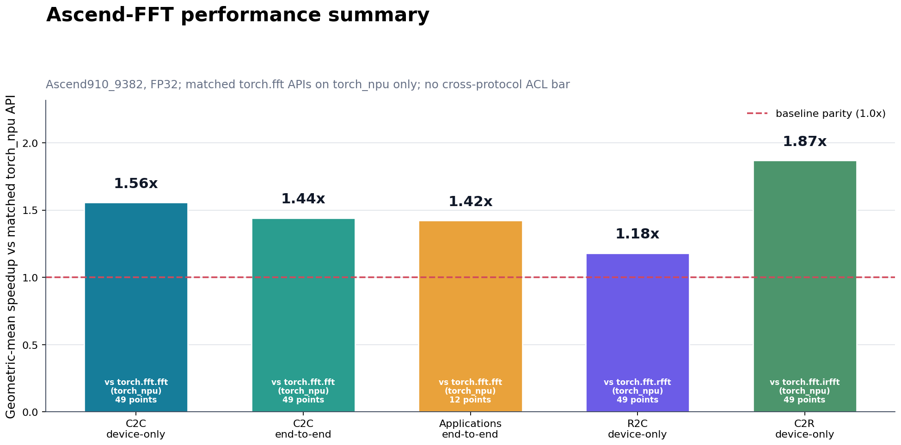
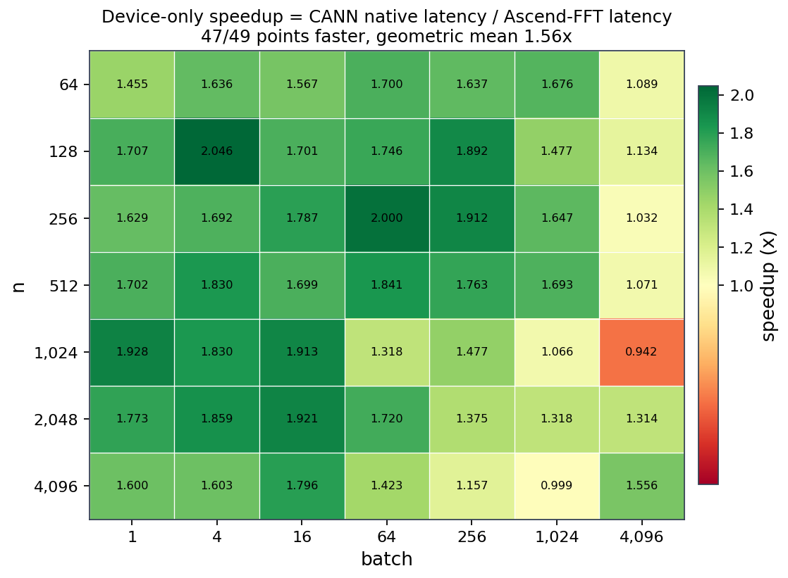
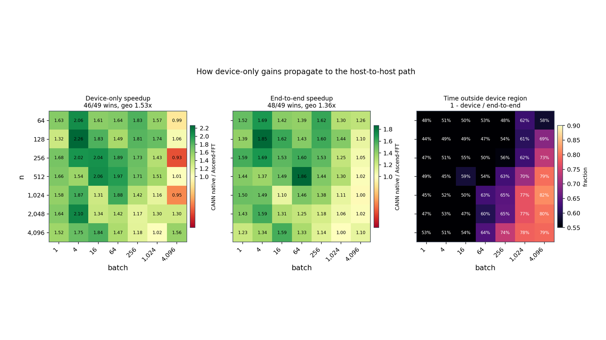
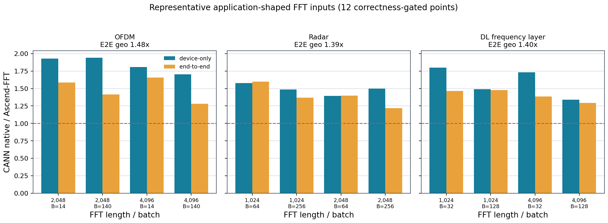
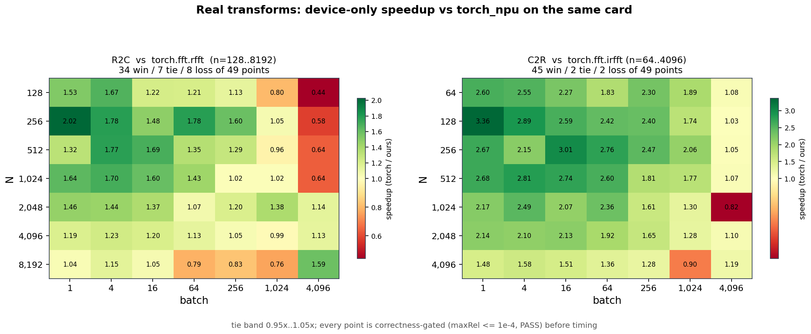

# 当前实验结果

> **当前发布快照**：`ascend910_9382-revalidation-20261010` · Ascend910_9382 · CANN 9.0.0 ·
> fp32。快照目录位于 [GitHub results snapshot](https://github.com/TruNcat3/ascend-fft/tree/f1e97da/results/published/ascend910_9382-revalidation-20261010)。
> 本页只引用这一份加固后的快照；旧的 `cann9.0.0-v2` 数字保留在历史提交中，不再参与现行结论。

本仓库是 cuButterfly 的 Ascend 迁移实例。实验的交付目标是：在**预先声明的长度、batch、
精度和变换语义范围内**完成正确性门禁、同语义基线和可复现实测，并证明迁移后的计算流有收益。
这不是对所有 Ascend SoC、所有尺寸或所有计算核心的全局最优承诺。

## 一眼看结果

速度比定义为 `基线耗时 / Ascend-FFT 耗时`，大于 1 表示自研更快。几何均值在同一快照、同一
计时口径和同一工作负载集合内计算，不能与旧快照拼接。

| 实验 | 严格基线 | 点数 | 几何均值 speedup | 覆盖结论 |
|---|---|---:|---:|---|
| C2C device-only | CANN 原生复数 FFT（`torch_npu`） | 49 | **1.62x** | 48/49 点严格领先；最低 0.96x，最高 2.50x |
| C2C end-to-end | 同上，pinned H2D + FFT + D2H | 49 | **1.36x** | 48/49 点严格领先；最低 0.997x |
| 应用 shape end-to-end | OFDM / 雷达 / DL 频域层 | 12 | **1.42x** | 12/12 点领先 |
| R2C device-only | `torch.fft.rfft`（同卡同语义） | 49 | **1.18x** | 胜/平/负 = 34/5/10 |
| C2R device-only | `torch.fft.irfft`（同卡同语义） | 49 | **1.78x** | 胜/平/负 = 46/2/1 |

所有 C2C 点均通过 correctness gate（最大相对误差小于 `1e-4`，实际约为 `1e-7`）；R2C/C2R
采用对称 5-trial 协议，失败行不会进入 timing 汇总。这里的“平”使用 `0.95x..1.05x`
区间，胜负统计与几何均值是两个不同维度。

## C2C 网格

矩阵为 `N ∈ {64,128,256,512,1024,2048,4096}` 与
`batch ∈ {1,4,16,64,256,1024,4096}` 的 49 个组合，每点 3 轮、每轮 20 次稳态执行，
自研与 CANN 原生 runner 交错执行。完整数值见[发布矩阵](../generated/matrix.md)，原始 CSV
和协议见快照目录。

大多数点位的收益来自阶段/数据二维映射、UB 内复用和硬件相关的 lowering；随着 batch 增大，
两条路径都接近持续吞吐区，倍率自然收窄。当前唯一严格回退点是 `N=1024,batch=4096`
（约 `0.96x`），它已列为下一轮的定向优化项，而不是从矩阵中删除。

## 端到端与应用 shape

端到端计时包括 pinned H2D、一次前向 C2C 和 D2H，因此不会把 kernel 倍率直接等同于应用
倍率。49 点的 E2E 几何均值为 **1.36x**；最低点仍接近持平，说明搬运与同步已经成为主要
限制之一。

12 个代表 shape 全部领先，按应用标签分组的 E2E 几何均值为：

| 应用组 | 点数 | 几何均值 |
|---|---:|---:|
| OFDM | 4 | 1.43x |
| Radar | 4 | 1.37x |
| DL frequency-domain layer | 4 | 1.46x |

这些是公开脚本中定义的代表输入，不等价于完整通信、雷达或深度学习应用端到端加速。

## R2C / C2R

R2C 和 C2R 使用同样的 5-trial 对称协议：每个 trial 先执行一次丢弃的 warmup，再对稳态
样本取 median；逐 trial correctness、`maxAbs`、`maxRel` 和状态全部保留在 raw 文件中。

| 实验 | 点数 | 几何均值 | 胜 / 平 / 负（±5% parity band） |
|---|---:|---:|---:|
| R2C vs `torch.fft.rfft` | 49 | **1.18x** | **34 / 5 / 10** |
| C2R vs `torch.fft.irfft` | 49 | **1.78x** | **46 / 2 / 1** |

R2C 的负点主要集中在小长度、大 batch；这属于当前实验范围内的已知边界，后续优先检查
batch 折叠、搬运占比和 CANN 原生路径的调用开销。C2R 的单个负点同样保留在 raw 数据中。

## 设计点与实验范围

本轮已经完成“迁移实例”所需的主要闭环：

1. 用 Ascend910_9382 profile 约束 UB、AIV、对齐和数据通路；
2. 在声明矩阵上运行参数化候选并回填实测结果；
3. 将 C2C、E2E、应用 shape、R2C/C2R 分开报告，避免混合语义；
4. 发布正确性、协议、源码 commit、硬件身份和产物哈希。

因此本版本可以收敛为一个可复现的迁移实例。仍需改进但不阻塞本版本发布的项目包括：

- C2C 的一个高 batch 边界点和 R2C 的若干负点；
- profile 原始附件、cube probe 和 `msprof` 计数器归档；
- pp2 实验路径的自动晋升与 UB 峰值模型一致性；
- 逆向 C2C、更多精度、非二次幂、2D/stride 和其他 Ascend SoC。

这些项目进入[未来计划](../roadmap.md)，不会被写成当前已支持或已达到全局最优的能力。

## 原始数据与复现

- [当前发布快照](https://github.com/TruNcat3/ascend-fft/tree/f1e97da/results/published/ascend910_9382-revalidation-20261010)
- [C2C 发布矩阵](../generated/matrix.md)
- [多基线明细](../generated/comparison.md)
- [测量方法](methodology.md)
- [复现实验命令](reproducibility.md)
- [图表生成器](https://github.com/TruNcat3/ascend-fft/blob/f1e97da/scripts/plot_results.py)

图、摘要和 raw 数据必须来自同一发布快照；禁止从不同日期、硬件或计时协议拼接结论。
