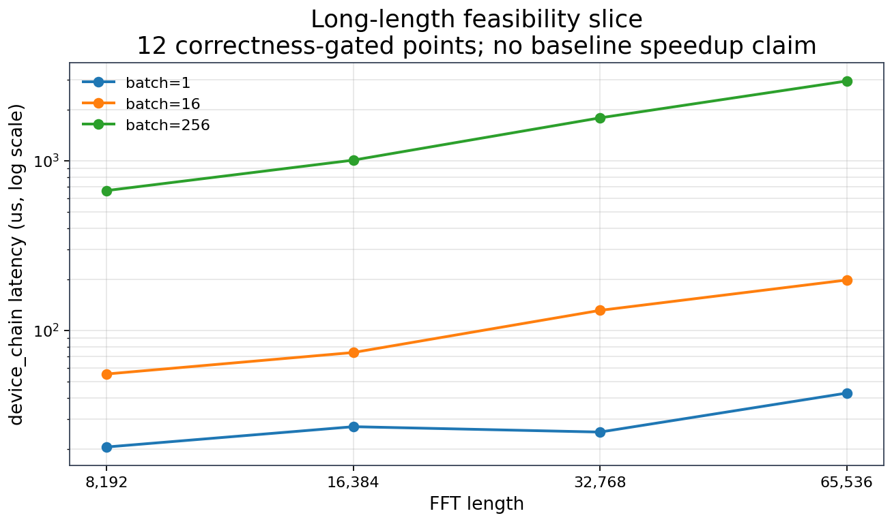

# 规模扩展：长 FFT 切片

## 实验问题

当前迁移实例的能力是否只限于短FFT？本实验以少量长长度和不同batch验证已有分段
lowering的可执行性、数值正确性和设备时间趋势。它是规模扩展的增强证据，**没有同协议
外部基线，因此不能声称长FFT已实现加速或超过专业库**。

## 配置与变量

| 项目 | 本次配置 |
|---|---|
| 硬件与软件 | Ascend910_9382，CANN 9.0.0 |
| 语义 | fp32 前向1D C2C，已实现的长FFT分段路径 |
| 长度 N | 8192、16384、32768、65536 |
| Batch | 1、16、256 |
| 覆盖 | 12个形状，每形状3个独立trial，共36条raw记录 |
| 正确性 | 每条记录PASS、误差有限且 `maxRel <= 1e-4` |
| 设备时间 | trial内`device_chain`最小值，再取跨trial中位数 |

设备时间统计应读为 **median of per-trial minima**。采集JSON中的通用protocol标签写作
“per-trial median”，但当前`device_chain`字段由C++ runner输出trial内最小值；本页按
实际字段含义说明，不把它与主C2C矩阵的min-of-means或实数变换的median协议混为一谈。
`wall_us`另行保留，不将它当作已匹配外部基线的E2E速度比。

## 长度、负载与设备延迟

图展示对数坐标下的设备链延迟。增大 batch 可摊销部分固定成本，但也会增加总工作量；
不同长度的分段和片上资源约束不同，不能从这 12 个点直接推断稳态吞吐规律。

## 数值结论

下表为设备链时间，单位为微秒；每格对应3个trial输出的中位数。

| 长度 N | Batch=1 | Batch=16 | Batch=256 |
|---|---:|---:|---:|
| 8192 | 20.5 | 55.2 | 665.5 |
| 16384 | 27.0 | 73.9 | 1005.8 |
| 32768 | 25.1 | 130.9 | 1785.1 |
| 65536 | 42.6 | 197.6 | 2942.7 |

**12/12形状、36/36原始trial全部正确**，最大记录相对误差为 **2.372e-7**。
最大形状 `65536 × 256` 含16,777,216个复数点，设备链中位时间为2.943ms；这证明
当前实现已经能执行超出单块短FFT长度的规模切片，并保留了完整原始记录。

## 限制与解释

该结果没有匹配的Torch/CANN长FFT对照，也没有逐项受控消融，不能推出架构最优、全面
领先或负载越大越有优势。只有3个trial，p10/p90与CV是描述性离散度，不作显著性证明；
少量低batch点的波动也意味着不能把单个相邻长度的时间倒序解释为稳定架构规律。

规模切片不代表预声明长FFT研究矩阵全部完成。长度更广的独立基线、数值模式、边界布局、
GM/UB流量、实际计算/搬运重叠，以及完整长应用流水仍在后续计划中。该实验接口的能力
也不等价于公开短FFT Plan API已经支持同一范围。

## 原始数据与复现

- [12点规模汇总](https://github.com/TruNcat3/ascend-fft/blob/master/results/published/ascend910_9382-migration-20261013/scale_slice.csv)
- [统计与逐点状态](https://github.com/TruNcat3/ascend-fft/blob/master/results/published/ascend910_9382-migration-20261013/scale_slice.json)
- [36条原始trial](https://github.com/TruNcat3/ascend-fft/blob/master/results/published/ascend910_9382-migration-20261013/scale_slice.raw_trials.csv)
- [运行manifest](https://github.com/TruNcat3/ascend-fft/blob/master/results/published/ascend910_9382-migration-20261013/manifest.json)
- [后续长FFT实验计划](long-fft-plan.md)
- [复现实验入口](reproducibility.md)

下一步阅读：[原始数据与复现](reproducibility.md)。
